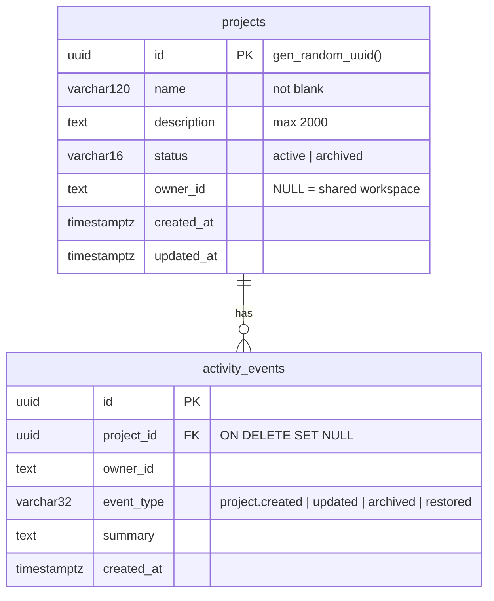
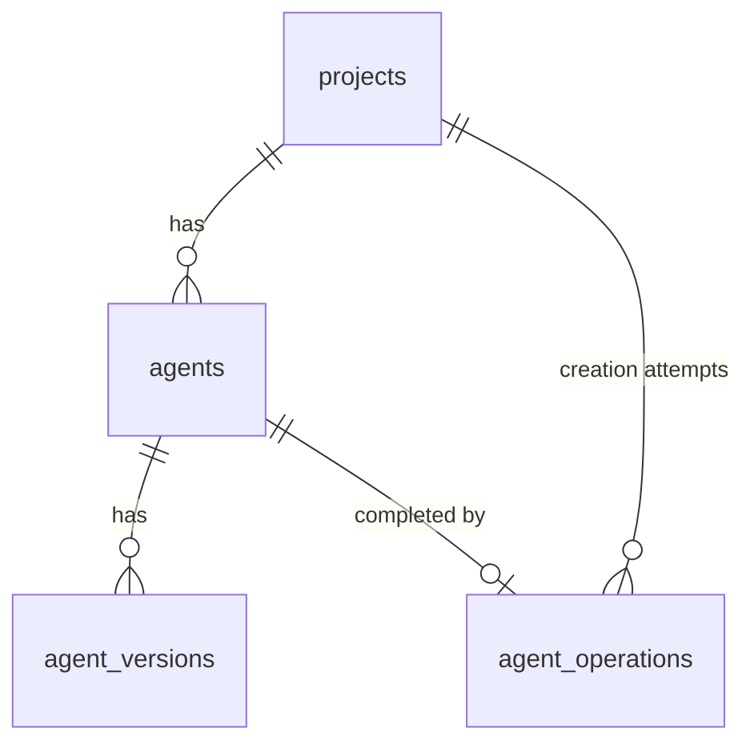

# Data model

## Implemented now (migration `0001_init.sql`)

Constraints and indexes: name not blank (CHECK), status and event type enumerated (CHECK), description length (CHECK), unique index on `lower(name)` for active projects only, index on `(status, updated_at DESC)`, index on `activity_events(created_at DESC)`. `schema_migrations(name, applied_at)` tracks applied files.

Only entities needed by delivered features exist. Activity exists because the dashboard shows real activity. No result, transcript or metric tables exist, and no serialized fake results are stored.

## Added in Phase 2 (migration `0002_agents.sql`)

- `agents`: project, owner, name, description, use case, creation prompt, current `config` (jsonb), `config_version`, `synced_version`, voice, primary language, `remote_agent_id` (NOT NULL, unique), status (`active`, `remote_missing`, `remote_deleted`, `archived`), remote check time and note.
- `agent_versions`: immutable configuration snapshots with summary, source and sync status; unique on `(agent_id, version)`.
- `agent_operations`: one row per creation attempt, unique idempotency key, status (`pending`, `remote_created`, `completed`, `failed`, `unknown`, `dismissed`), config snapshot, remote id when known.
- `activity_events` accepts agent event types.

## Planned entities and how they attach

| Entity | Phase | References |
| --- | --- | --- |
| agent_configs, agent_versions | 2 (delivered as `agents` and `agent_versions`) | `project_id`; the agent stores the ElevenLabs agent id returned by the API |
| customer_personas | 3 | `project_id` |
| test_scenarios (with success criteria) | 4 | `project_id`, optional persona |
| test_runs | 4 | scenario, agent version; stores ElevenLabs test and invocation ids |
| transcripts | 5 | test run |
| findings | 5 | test run |
| fix_proposals | 6 | finding |
| regression_results | 6 | fix proposal, test run |

Every table carries `project_id` and `owner_id` so scoping stays uniform. Migrations are append-only numbered SQL files.

## Known limitation

The unique name index is global across owners. When per-user ownership is introduced, replace it with `(coalesce(owner_id, ''), lower(name))`.
